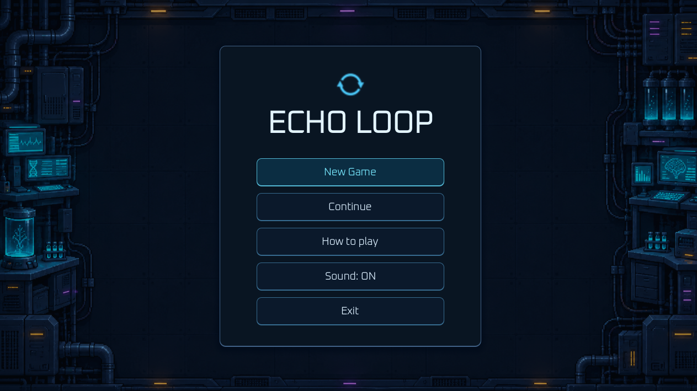
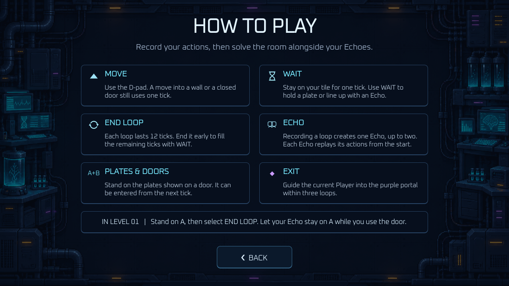
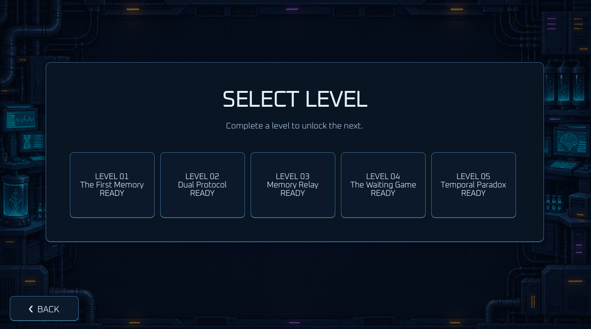
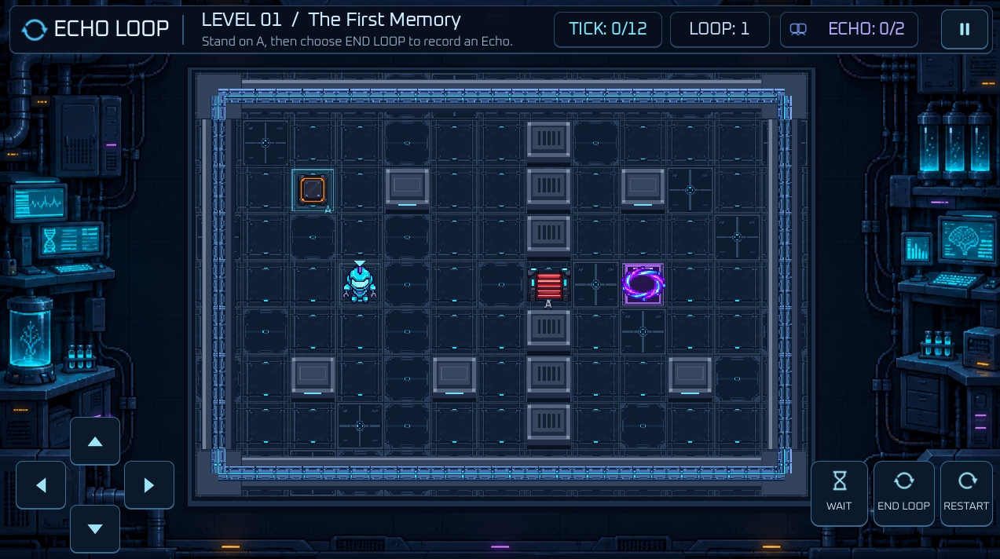

# Echo Loop — 2D Time-Loop Puzzle Game

**A sci-fi puzzle adventure where your past actions become your greatest allies.**


Echo Loop is a 2D top-down puzzle game developed with Godot 4.7.2 and GDScript by a five-member Software Engineering student team.

Record your actions across time loops, cooperate with your past selves, activate pressure plates, and unlock the exit before time runs out.

## Download Echo Loop

**Version 1.0.0 — Android Release APK**

[**Download APK (Google Drive)**](https://drive.google.com/file/d/1iarFzLn8ydw5haG9LYywCWPuOHcgVKuI/view?usp=sharing)

[**View GitHub Release v1.0.0**](https://github.com/nguyendl8957/echo-loop/releases/tag/v1.0.0)

### Scan to Download


Scan this QR code using your Android phone to open the APK download page.

### Installation

1. Download `EchoLoop.apk`.
2. Open the downloaded APK on your Android device.
3. Allow installation from the selected source if Android prompts you.
4. Install and launch Echo Loop.

The game supports offline play. Version 1.0.0 was manually tested on Google Pixel 10; compatibility with other devices is not fully verified.

## Game Screenshots

| Main Menu | How to Play |
|:---:|:---:|
|  |  |

| Level Selection | Gameplay |
|:---:|:---:|
|  |  |

## Core Features

- **Time Loop:** Plan actions within 12 ticks per loop.
- **Echo Replay:** Create up to two Echoes that replay previous actions.
- **Puzzle Mechanics:** Coordinate pressure plates, doors, and timed movement.
- **Five Levels:** Progress from your first Echo to complex temporal puzzles.
- **WAIT Action:** Synchronize movements and switch activation across timelines.
- **Sci-Fi Interface:** Futuristic laboratory visuals and responsive touch controls.
- **Local Progress:** Save unlocked levels and sound preferences.
- **Offline Gameplay:** No account or internet connection required.

---


Echo Loop is a 2D top-down, grid-based puzzle game developed with Godot 4.7.2 and GDScript. It is a university software engineering project built by a five-member student team, targeting offline Android gameplay.

## Project Status

**Current phase:** v1.0.0 released. Sprint 05 implementation and Leader-reported Android QA completed.

Implemented in the integrated source:
- Five playable puzzle levels.
- Player movement on a grid.
- A deterministic 12-tick time-loop system.
- Up to two Echo actors replaying recorded actions.
- Pressure switches, linked doors, and exit portals.
- Main Menu, Level Select, Tutorial, HUD, Pause, and Level Complete screens.
- Local level-unlock and sound-preference persistence.
- Sound ON/OFF control in Main Menu.
- Back navigation for menu and gameplay screens.
- Updated HUD styling and Android branding.

The Leader has reported passing PC F5 tests for Sound Settings, Back navigation using Escape, and related gameplay regression.

**Release status:** Signed Android APK v1.0.0 published. Leader-reported Android acceptance and remaining verification limitations are recorded in the [QA report](tests/final_qa_report.md).

## Technical Requirements

- Godot 4.7.2 stable, Standard/GDScript.
- GL Compatibility renderer.
- Landscape-oriented Android target.
- Android SDK, JDK, and matching export templates for APK builds.
- Git and GitHub for source control.
- No server, Firebase, or internet connection required for gameplay.

## Getting Started

1. Clone the repository into a new directory.
2. Open Godot 4.7.2 Project Manager.
3. Import the repository's `project.godot`.
4. Wait for the initial resource import.
5. Press F5 to start from Main Menu.
6. Select New Game to enter Level 01.
7. Use F6 to run a selected test scene independently.
8. Inspect Output and Debugger for parser or runtime errors.

Use Ctrl+S after editing scripts, scenes, or resources and before running tests.

## Gameplay Rules

- Actions: UP, DOWN, LEFT, RIGHT, WAIT.
- Each loop contains exactly 12 ticks.
- WAIT consumes one tick.
- A blocked movement consumes one tick without changing position.
- Ending a loop early pads its recorded history with WAIT.
- A maximum of two Echoes can exist.
- Echoes replay previously recorded action histories.
- Player and Echo actors may occupy the same grid cell.
- Actors use the door-state snapshot captured at the beginning of a tick.
- Actor movement is resolved before switches and doors update.
- Linked doors open only when all required switches are activated.
- Only the current Player can complete a level at Exit.
- The run fails after the third loop if the Player has not won.
- Restart resets the current run and its Echo histories.

The order of tick processing is part of the gameplay contract and must not be changed without an approved design decision.

## Levels

| Level | Name | Main Concept | Minimum Echoes |
|---|---|---|---:|
| 01 | The First Memory | Record a route to a pressure plate | 1 |
| 02 | Dual Protocol | Hold two plates simultaneously | 2 |
| 03 | Memory Relay | Use Echo 1 to open the route for Echo 2 | 2 |
| 04 | The Waiting Game | Time a handoff between adjacent plates | 2 |
| 05 | Temporal Paradox | Combine a relay and a handoff within 12 ticks | 2 |

The game currently targets five levels. Difficulty and visuals may be refined later, but each modified puzzle must retain a documented valid solution.

Level resources are stored in `data/levels/`. See [Level Design V2 solutions](tests/level_design_v2.md) for routes and tick traces.

## User Interface

Main Menu:
- New Game
- Continue
- How to play
- Sound: ON/OFF
- Exit

Continue opens Level Select; it does not restore an unfinished tick or run.

Gameplay HUD:
- LEVEL, TICK, LOOP, ECHO
- Four-direction D-pad
- WAIT, END LOOP, RESTART
- Pause icon at the top right

Other screens:
- Tutorial
- Level Select
- Pause Menu
- Level Complete

### Back Navigation

| Screen | Back Action |
|---|---|
| Main Menu | Exit application |
| Tutorial | Return to Main Menu |
| Level Select | Return to Main Menu |
| Gameplay | Open Pause Menu |
| Pause Menu | Resume gameplay |
| Level Complete | Open Level Select |

PC Escape and Android Back navigation were manually tested by the Leader.

## Save and Audio

The local save system stores:
- `unlocked_level`
- `sound_enabled`

It does not store:
- The current tick or loop
- Player or Echo positions
- Echo action histories
- An unfinished gameplay run

Sound settings can be changed in Main Menu and are persisted through the existing GameManager and SaveManager APIs.

## Repository Structure

```text
project.godot
scenes/
  menus/
  gameplay/
  player/
  puzzle/
  ui/
  tests/
scripts/
  core/
  timeloop/
  player/
  puzzle/
  ui/
  data/
assets/
  sprites/
  audio/
  fonts/
  branding/
data/
  levels/
docs/
tests/
```

This is a logical directory overview. Git does not preserve empty directories.

## Team Responsibilities

| Role | Responsibility |
|---|---|
| Leader | Game Core, Time Loop, integration, release configuration, final QA approval |
| TV2 | Player, Echo, actor visuals, movement QA |
| TV3 | Puzzle mechanics, level resources, puzzle QA |
| TV4 | HUD, menus, tutorial, Android UI QA |
| TV5 | Save, Audio, test reports, release documentation |

Changes to shared Core, Gameplay, or project configuration files require Leader review.

## Development Workflow

1. Update the working branch from the approved main baseline.
2. Read the relevant Issue and `docs/module_contract.md`.
3. Modify only the approved file scope.
4. Save changed resources and scripts.
5. Run relevant F6 tests and F5 regression.
6. Record actual test results and evidence.
7. Commit only intended files.
8. Push a feature branch and open a Pull Request.
9. Review changes and merge one PR at a time.
10. Repeat relevant regression tests after integration.

Never treat an unexecuted test as PASS.

## Test and Release Documentation

- `docs/module_contract.md`
- `docs/android_export_guide.md`
- `docs/user_guide_vi.md`
- `docs/known_issues.md`
- `tests/android_actor_qa.md`
- `tests/android_levels_qa.md`
- `tests/android_ui_qa.md`
- `tests/ui_device_matrix.md`
- `tests/android_test_matrix.md`
- `tests/final_qa_report.md`
- `tests/release_checklist.md`

The Vietnamese user guide is a separate deliverable. This README and the two technical documents updated with it are maintained in English.

## Release Acceptance

Sprint 05 can only be accepted after:
- Final source integration and regression.
- Updated solutions for all changed levels.
- Final APK export from a recorded source commit.
- Physical Android install and launch.
- Five-level end-to-end gameplay verification.
- Touch UI, Back, pause, save, and audio checks.
- Offline operation and close/reopen verification.
- Device, OS, tester, APK SHA-256, and evidence recorded.
- No unresolved release-blocking defects.
- Leader approval of the final QA report.

PC F5 success or an earlier Debug APK does not establish final release approval.

## Security

Never commit:
- APK/AAB build outputs
- Keystores and signing passwords
- Private keys or credentials
- The `.godot/` import/cache directory
- Local private test data

Signing configuration is maintained outside version control.

## Historical Note

The original Skeleton v0.1.1 and Sprint 02–04 records describe earlier milestones. The current source and approved module contract take precedence over those historical descriptions.
